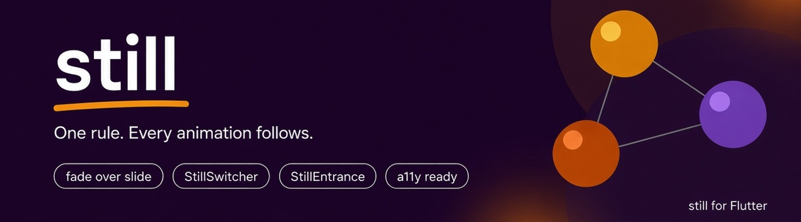

# 🎞️  still

[](https://pub.dev/packages/still)
[](https://flutter.dev)
[](LICENSE)


Motion that knows when to stop.

Someone turns on Reduce Motion, and a slide becomes a fade. Someone turns animations off, and the next state is already on screen. You set that rule once. Every animation you opt into follows it.

## Install

```yaml
dependencies:
  still: ^0.1.9
```

```dart
import 'package:still/still.dart';
```

## How it fits together

There are two pieces.

The **rule** is `MotionScope`. Put it above the app, once. It reads the phone and decides: slide, fade, or cut. That decision covers every screen underneath.

The **motion** is a widget you place only where something should move. A title, a card, a list, a new page. The rest of the screen stays still, because nothing there was asked to move.

## 1. Wrap the app

In `main.dart`, `MotionScope` is the parent of `MaterialApp`.

```dart
void main() {
  runApp(
    const MotionScope(
      child: MaterialApp(
        home: HomePage(),
      ),
    ),
  );
}
```

`WidgetsApp` takes the same parent. The package never imports Material, so a custom design system can use it as-is.

Leave `preference` alone and the phone decides. Pass one when you want to preview a mode on your machine:

```dart
const MotionScope(
  preference: MotionPreference.reduced,
  child: MaterialApp(
    home: HomePage(),
  ),
)
```

| Preference | What you see |
| --- | --- |
| `platform` | Follows the phone. This is the default. |
| `full` | Slides, scale, and the pause between items run. |
| `reduced` | Travel is off. A cross-fade remains, long enough to see. |
| `off` | Nothing animates. The next state is already there. |

## 2. Mark the places that move

**A line or card that swaps.** The same job as `AnimatedSwitcher`. The `Key` is how `still` knows the child changed.

```dart
StillSwitcher(
  child: Text(line, key: ValueKey(line)),
)
```

**Something that enters once**, such as a card when the screen opens. Change the `Key` to play the entrance again.

```dart
StillEntrance(
  motion: StillMotion.slideUp,
  child: const CardBody(),
)
```

**A short list that arrives in sequence.** One clock for the whole list. When travel is off, the later items show up together.

```dart
StillStagger(
  children: const [
    Note(title: 'Duration'),
    Note(title: 'Travel'),
  ],
)
```

**A new screen.** Use it where you would push a `MaterialPageRoute`. The page comes in 64 pixels from the trailing edge. Going back is shorter.

```dart
Navigator.of(context).push(
  StillPageRoute<void>(
    builder: (_) => const DetailPage(),
  ),
);
```

**An animation you already wrote.** Keep your own clock. Ask the scope if travel is allowed, and scale your offset by that answer.

```dart
final motion = MotionScope.of(context);
final dx = motion.travels ? 16 * controller.value : 0.0;
```

## What the phone is asking

| Setting | What `still` does |
| --- | --- |
| Reduce Motion, usually from iOS | Slide, scale, and stagger become zero. The fade keeps its time, so the change stays visible. |
| Remove animations, usually from Android | The time becomes zero. The next state is already on screen. |

Flutter stores both settings. It leaves your slides alone. `AnimationController` ignores Reduce Motion on purpose: a fade is a different transition, and the widget is supposed to choose it. Most widgets never do. `still` chooses once, in `MotionScope`.

Remove animations is also read by `AnimationController` itself. A `MediaQuery` cannot turn that engine flag back on, and neither can `MotionPreference.full`. On a phone with animations removed, controllers still jump to the end.

## Try it in a test

You can force the decision without changing the operating system.

```dart
await tester.pumpWidget(
  const MotionScope(
    preference: MotionPreference.reduced,
    child: Directionality(
      textDirection: TextDirection.ltr,
      child: MyScreen(),
    ),
  ),
);
```

Or drive the platform flag:

```dart
tester.platformDispatcher.accessibilityFeaturesTestValue =
    const FakeAccessibilityFeatures(reduceMotion: true);
```

`MediaQueryData(disableAnimations: true)` above the scope is Remove animations.

## Gallery

The app in `example/` shows Platform, Full, Reduced, and Off on a switcher, a stagger, a hand-written loop, and a page route.

```bash
cd example
flutter run
```

## Shared timing

`MotionScheme` holds the numbers every widget shares: `fast` (140 ms), `medium` (280 ms), `slow` (420 ms), and `travel` (24 pixels). Pass a scheme to `MotionScope` when the whole app should use other values. A single widget can still override its own duration and distance.

On Flutter 3.47 and earlier, Reduce Motion comes from `AccessibilityFeatures.reduceMotion`. Flutter 3.50 adds `MediaQueryData.reduceMotion`, which a test or a parent widget can override. `MotionScope` reads that field when the SDK has it.

`skills/still/SKILL.md` ships inside the package. An app that depends on `still` can install it with `dart run skills@ get`.

## License

BSD 3-Clause. Copyright 2026 Pedro Ruffo.
